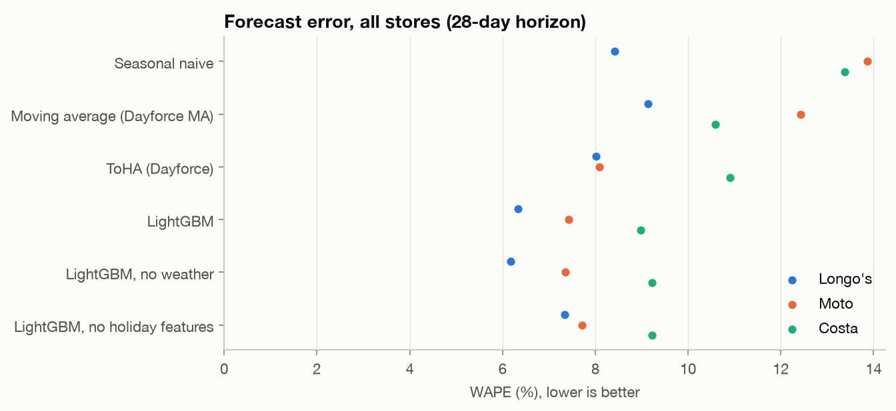
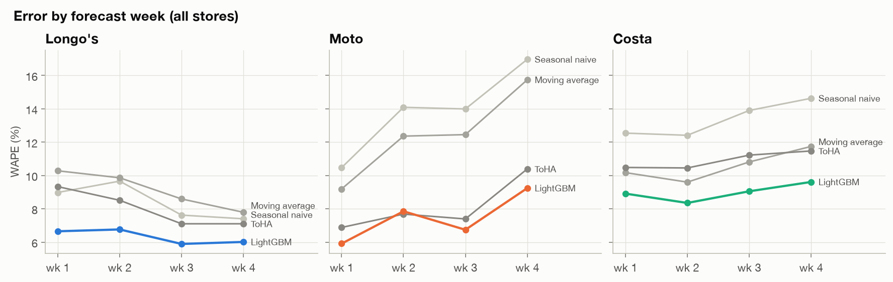

# Store sales forecasting for workforce scheduling

Daily sales forecasts, 28 days ahead, for 978 retail stores across three clients of a
workforce-management platform. Labour schedules are built from these forecasts, so a few
points of forecast error turn directly into over- or under-staffed shifts.

This project rebuilds a University of Toronto capstone (MIE490, with Dayforce) from the raw
data up: cleaning, external data, EDA, and a rolling backtest that compares the platform's
current methods with statistical and machine-learning models.

**Result:** one LightGBM model per client cuts forecast error (WAPE) by 9–21% compared with
the best current method, with the largest gains on public holidays and retail events.



| Model | Longo's (39 stores, Canada) | Moto (64, UK) | Costa (875, UK) |
|---|---|---|---|
| Moving average (current) | 9.1% | 12.4% | 10.6% |
| ToHA (current) | 8.0% | 8.1% | 10.9% |
| Prophet* | 9.5% | 8.8% | 10.4% |
| Dynamic harmonic regression* | 8.1% | 10.4% | 10.2% |
| **LightGBM** | **6.3%** | **7.4%** | **9.0%** |

WAPE over 6 rolling 28-day windows, trading days only. *Per-store models, run on a
197-store sample (LightGBM on that sample: 6.3% / 7.4% / 9.2%). Full results:
[reports/results.md](reports/results.md).

## What changed from the original capstone

| | Capstone | This project |
|---|---|---|
| Evaluation | 1 store, 1 test window | 978 stores, 6 rolling windows, 28-day horizon |
| Metric | MAPE | WAPE (weights stores by size) and bias |
| Model chosen | Prophet + historical average (6.59% MAPE) | LightGBM, one global model per client |
| Holidays | client special days, assigned to parent org units only | expanded to every store, plus regional public holidays (Scotland differs) and retail events |
| Weather | Canada only | Canada and UK (115 grid cells via Open-Meteo) |
| Data quality | not addressed | documented and checked: placeholder zeros, truncated export, closures, anomalies |

On the capstone's own store, Prophet's error ranges from 5.5% to 9.3% across the six
windows, so a single window cannot separate models that differ by about a point. Measured
across all stores and windows, Prophet does not consistently beat the current ToHA method,
which is why it was replaced.

## Key findings

- **Holidays are where models differ.** On special days LightGBM's WAPE is 13% / 6% / 13%
  versus 21% / 16% / 16% for ToHA. Removing the holiday features erases most of that gain.
- **Holiday effects are client-specific.** The Ontario grocer closes on statutory holidays;
  UK motorway services sell 40–58% more on bank holidays; Christmas peaks fall on different
  days for each client.
- **Weather matters less than expected.** After removing seasonality the effects are a few
  percent (heavy rain −5 to −6%), and adding weather helps only the coffee chain
  (9.2% → 9.0%) even with perfect hindsight weather.
- **Recent same-weekday history dominates.** The mean of the same weekday over the last 8
  weeks is the top LightGBM feature for every client.



## Pipeline

```
raw Excel exports ──ingest──▶ interim parquet ──clean + checks──▶ processed tables
                                                     ▲
           postcodes.io (UK geocoding) ─▶ Open-Meteo (weather)   holidays package + retail events
                                                     │
processed ──build_dataset──▶ analysis_daily (store × day) ──▶ eda
                                                     └──▶ features ──▶ backtest (baselines, LightGBM)
                                                                  └──▶ stat_models (Prophet, DHR)
                                                                           └──▶ evaluate
```

| Step | Module | Output |
|---|---|---|
| Ingest | `src/ingest.py` | `data/interim/*.parquet` |
| Clean and validate | `src/clean.py`, `src/checks.py` | sales, stores, quality log |
| UK geocoding and weather | `src/geocode_uk.py`, `src/weather_uk.py` | weather per store-day |
| Holiday calendar | `src/holiday_calendar.py` | public holidays and retail events by region |
| Analysis table | `src/build_dataset.py` | `analysis_daily.parquet`, 969,360 store-days |
| EDA | `src/eda.py` | [reports/eda.md](reports/eda.md), figures 01–08 |
| Features and baselines | `src/panel.py`, `src/features.py` | one row per store × origin × horizon |
| LightGBM backtest | `src/backtest.py` | forecasts, feature importance |
| Prophet and DHR | `src/stat_models.py` | forecasts on the store sample |
| Evaluation | `src/evaluate.py` | [reports/results.md](reports/results.md), figures 09–10 |

## Method notes

- **Backtest.** For each of 6 origins, 28 days apart, every model is refit on data up to the
  origin and forecasts days 1–28. All history features use only days on or before the origin.
- **Direct multi-horizon model.** Each training row is (store, origin, horizon). The target is
  sales divided by the store's 28-day level, so one model serves stores of any size. An L1
  objective weighted by level optimises WAPE directly.
- **Baselines** reproduce the platform's current methods: a 4-week same-weekday moving average,
  and ToHA (last year's same-weekday average scaled by year-on-year growth).
- **Statistical models.** Prophet and dynamic harmonic regression (day-of-week dummies, 4 yearly
  Fourier pairs, ARIMA errors via `statsforecast` AutoARIMA) on log sales, with the same holiday,
  closure and weather regressors.
- **Weather** is the observed value on the target day, so its contribution is an upper bound.
- **Data window.** From 2022-01-01 onward, to avoid COVID-era disruption.

Data issues found and how each was handled: [reports/data_quality.md](reports/data_quality.md).
The original SQL extracts, with generalised table names, and a fixed version are in [sql/](sql/).

## Running it

The client data is confidential and not included in this repository.

```bash
python -m venv .venv && .venv/bin/pip install -r requirements.txt
```

On macOS, LightGBM needs OpenMP; `scripts/fix_lightgbm_macos.sh` points it at the copy bundled
with scikit-learn.

```bash
.venv/bin/python -m src.ingest
.venv/bin/python -m src.clean
.venv/bin/python -m src.geocode_uk
.venv/bin/python -m src.weather_uk
.venv/bin/python -m src.holiday_calendar
.venv/bin/python -m src.build_dataset
.venv/bin/python -m src.eda
.venv/bin/python -m src.backtest
.venv/bin/python -m src.stat_models
.venv/bin/python -m src.evaluate
```

`python -m src.q "SELECT ..."` runs DuckDB SQL over the processed tables. The LightGBM
backtest takes about 2 hours on a laptop, almost all of it on the 875-store client.

## Limitations

- Weather is observed rather than forecast.
- One client has under two years of clean data.
- LightGBM hyperparameters are fixed, not tuned.
- Prophet and DHR were run on a store sample.
