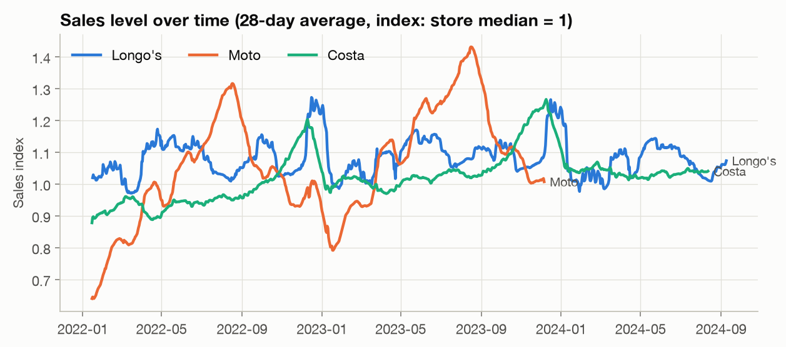
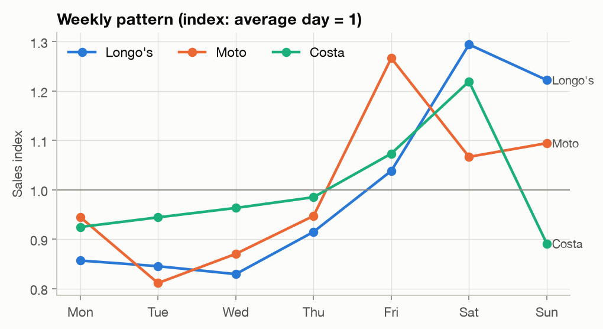
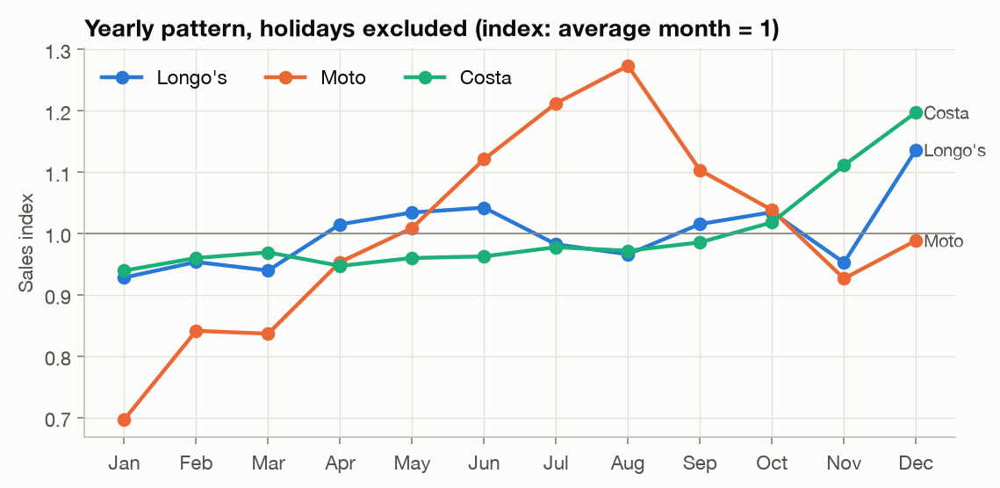
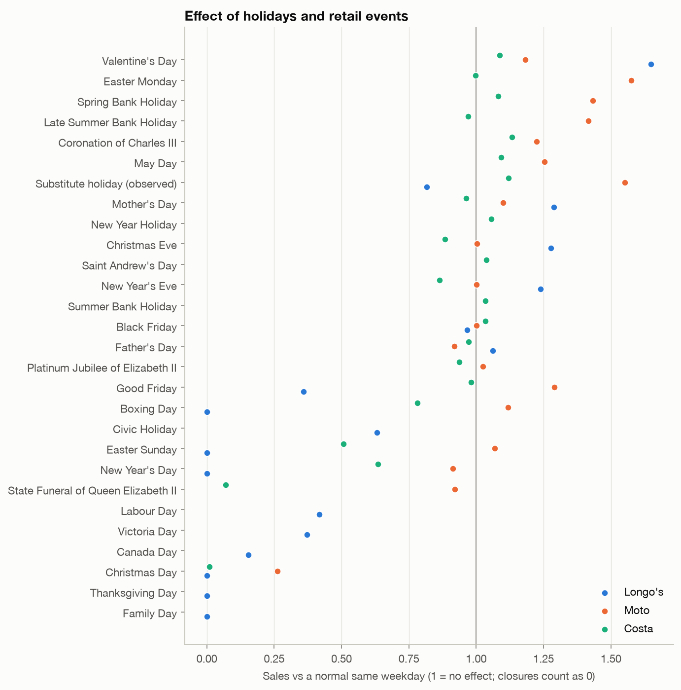
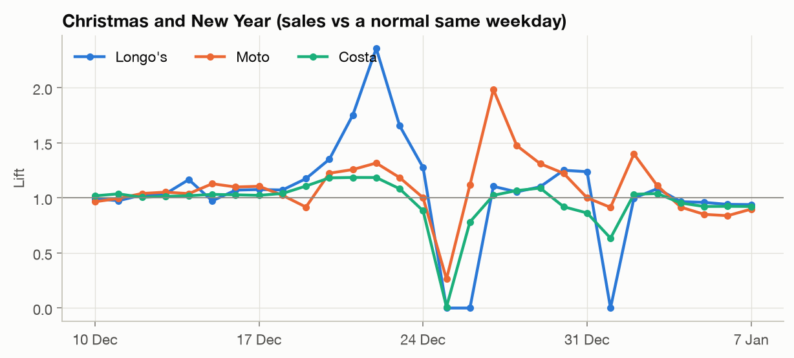
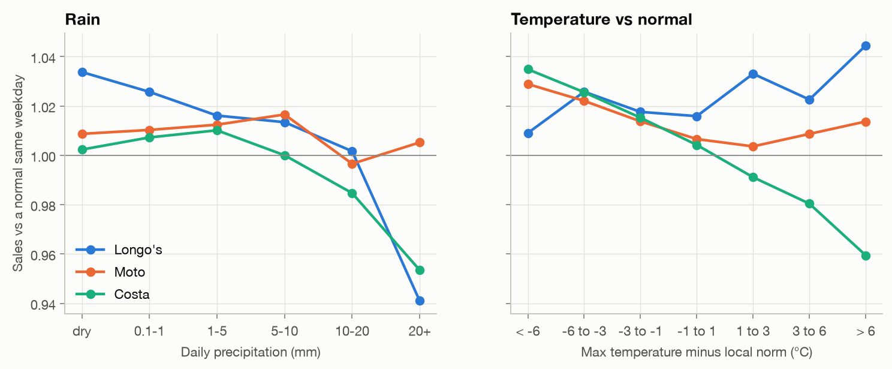
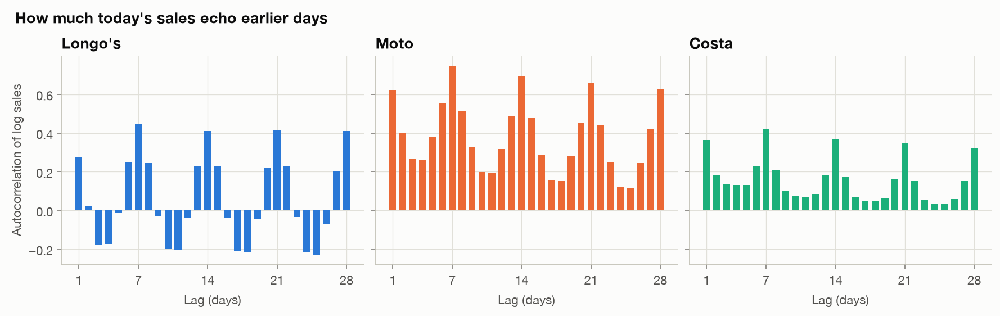
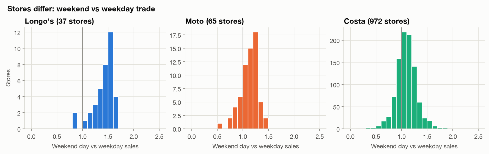

# Exploratory data analysis

Data: `data/processed/analysis_daily.parquet` (969,360 store-days: Longo's 39 stores in Ontario, Moto 65 UK motorway service areas, Costa 974 UK coffee shops). Figures and numbers are produced by `python -m src.eda`, and all values are in `reports/eda_stats.json`.

Two measures are used so that stores of very different size can be compared, and no absolute sales are shown:
- **Index:** sales divided by the store's median trading-day sales.
- **Lift:** sales divided by a *normal same weekday*, defined as the median of the same weekday 1–3 weeks before and after, ignoring holidays and closures. A lift of 1.2 means 20% above a normal day.

## 1. Trend: two clients are still growing

Median store change, same stores, January–August:

| | 2022 → 2023 | 2023 → 2024 |
|---|---|---|
| Longo's | −1.8% | −0.2% |
| Moto | +14.4% | n/a (data ends Dec 2023) |
| Costa | +9.7% | +2.8% |

Moto starts 2022 at about 65% of its normal level, consistent with the Omicron wave and post-COVID travel recovery. Costa grows steadily.
**Implication:** models need a level or trend component. Early-2022 Moto data understates normal demand and should be weighted down or handled with a trend term.

## 2. Weekly pattern: strong, and different per client

- **Longo's:** a weekend grocery shop. Saturday is +29% and Sunday +22%, while Monday–Wednesday run about 15% below average.
- **Costa:** Saturday is the peak (+22%) and Sunday the low (−11%).
- **Moto:** Friday is the peak (+27%, weekend getaway traffic) and Tuesday the low (−19%).

**Implication:** day of week is the single most important calendar feature, and the shape differs by client and by store (see section 8).

## 3. Yearly pattern

- **Moto:** strongly seasonal. August is +27% and January −30%, driven by summer travel. Part of the January low is the 2022 recovery effect.
- **Costa:** flat until autumn, then November +11% and December +20% (festive drinks and Christmas shopping).
- **Longo's:** fairly flat apart from December (+14%).

**Implication:** with only 2–3 years of history (2 for Moto), yearly seasonality must be modelled smoothly (a few Fourier terms, or month and week-of-year features), not as one free parameter per day.

## 4. Holidays: the same day means opposite things to each client

- **Longo's** is closed by law on most Ontario statutory holidays (Ontario's Retail Business Holidays Act). Family Day, Easter Sunday, Thanksgiving, Christmas, Boxing Day and New Year's Day are 100% closed. Other holidays are mixed: Good Friday 64% of stores closed, Victoria Day and Labour Day about 55%, Canada Day 78%. Gift days are strong: Valentine's Day +65% (checked: it holds in all three years on three different weekdays, Monday 2022, Tuesday 2023 and Wednesday 2024, at roughly 1.5–1.8× a normal same weekday, with 36–76% of stores above 1.3× their median; a grocer selling flowers, chocolate and dinner), Mother's Day +29%, Christmas Eve +28%.
- **Moto** is a travel business, so bank holidays are peak days: Easter Monday +58%, Spring Bank Holiday +43%, Late Summer Bank Holiday +42%, Good Friday +29%.
- **Costa** responds mildly to most holidays, apart from closures: Christmas Day almost entirely closed, Easter Sunday −49%, and the Queen's state funeral 93% closed.

**Implication:** holiday effects must be client-specific. A global model needs client × holiday interactions, which a tree model learns naturally. Closures are planned in advance, so whether a store will be open should be an input to the forecast, not something the model has to guess. The original model's single numeric `SpecialDayId` regressor could not represent any of this.

## 5. The days around holidays matter as much as the holidays

- **Longo's:** a steep pre-Christmas ramp (20 Dec +35%, 22 Dec +136%, 23 Dec +66%), then closed on 25 and 26 Dec and 1 Jan.
- **Moto:** two travel peaks, before Christmas (22 Dec +32%) and the return trip (27 Dec +98%).
- **Costa:** 20–22 Dec about +18%, then Christmas Eve and New Year's Eve below normal.

**Implication:** holiday features need windows (days before and after each holiday), not just a flag on the day itself.

## 6. Weather: small effects that only appear once seasonality is removed

Holidays and closures are excluded. Temperature is measured as the difference from the local norm for the time of year (a centred 31-day mean at the store's location).

- **Costa:** a warmer-than-normal day lowers sales (−4% when more than 6 °C above normal, +3.5% when more than 6 °C below), consistent with hot-drink demand. Heavy rain (20 mm or more) gives −5%.
- **Longo's:** heavy rain gives −6%, and warmer days are slightly up.
- **Moto:** no meaningful weather effect. Motorway traffic does not respond to daily weather.

Raw correlations, the approach used in the original project, are misleading:

| Correlation with sales | Longo's | Moto | Costa |
|---|---|---|---|
| Raw max temperature (original approach) | 0.01 | **0.18** | −0.03 |
| Temperature vs normal, deseasonalised | 0.04 | −0.04 | **−0.10** |
| Precipitation, deseasonalised | **−0.13** | −0.02 | −0.05 |

Moto's raw 0.18 only reflects that summer is both warm and busy. Once the season is removed, the relationship disappears. Costa's real temperature effect is hidden in the raw correlation.
**Implication:** feed weather as anomalies against the local norm, and expect at most a few percent improvement concentrated on extreme days. Whether weather helps at all is tested later with an ablation (model with and without weather).

## 7. Autocorrelation: weekly echo, and strong persistence at Moto

| Mean autocorrelation of log sales | lag 1 | lag 7 | lag 14 | lag 28 | lag 364 |
|---|---|---|---|---|---|
| Longo's | 0.27 | 0.44 | 0.41 | 0.41 | 0.62 |
| Moto | 0.62 | 0.75 | 0.69 | 0.63 | 0.79 |
| Costa | 0.36 | 0.42 | 0.37 | 0.32 | 0.36 |

**Implication:**
- Weekly lags (7, 14, 21, 28) and the same day last year (364) are the most informative history features.
- Residual autocorrelation is substantial, especially at Moto. This supports dynamic harmonic regression's ARIMA errors over Prophet's independent-error assumption.
- For a forecast 7–28 days ahead, yesterday's sales are not yet known. Lag features must be at least as long as the horizon, or the forecast must be made recursively.

## 8. Stores within a client differ

The weekend-vs-weekday sales ratio for Costa ranges from 0.87 (10th percentile) to 1.32 (90th percentile). 6% of stores sell clearly less at weekends, likely commuter or office locations, and 26% sell clearly more, likely leisure or retail parks. Moto ranges from 0.89 to 1.30. Longo's stores are all weekend-heavy, apart from two that close at weekends.
**Implication:** a single client-level weekly profile is not enough. A global model needs store identity, or store-level weekly profile features, to learn each store's own shape.

## Summary: what the models need

| Finding | Feature / modelling choice |
|---|---|
| Growth trend (Costa, Moto) | trend or level term, recent rolling means |
| Strong weekly shape, differing by store | day of week × store; lags 7/14/21/28 |
| Yearly seasonality from only 2–3 years | smooth terms (Fourier, month, week-of-year), lag 364 |
| Client-specific holiday effects and closures | holiday type × client, planned-closure input |
| Effects before and after holidays | holiday windows (days to/from each holiday) |
| Small, client-specific weather effects | weather anomalies vs local norm; test with ablation |
| Residual autocorrelation | ARIMA errors (DHR) and lag features (LightGBM), respecting the horizon |
