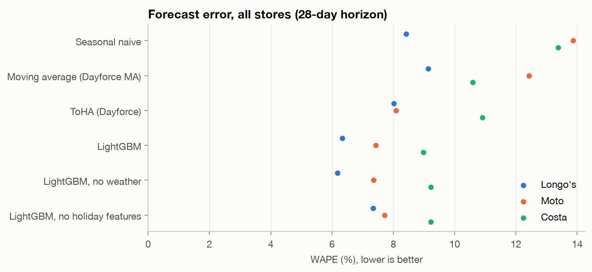
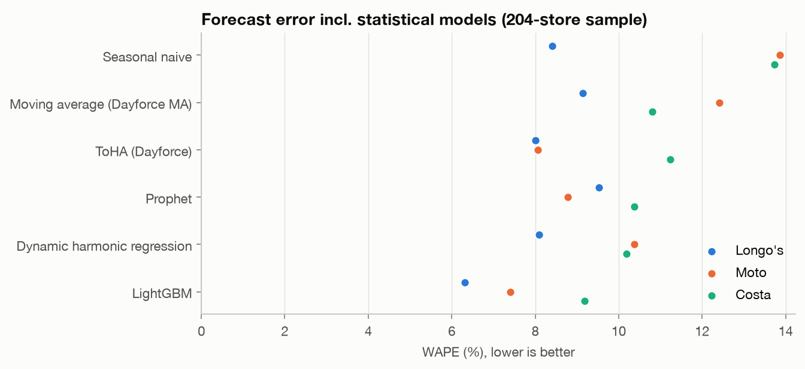
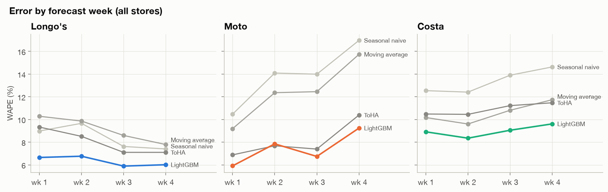

# Forecasting results

Daily store sales, 28-day horizon, three retail clients (one Canadian grocer, two UK
chains). Numbers come from `reports/metrics.json`, produced by `python -m src.evaluate`.

## How models were tested

- **Rolling origin.** 6 forecast origins per client, 28 days apart, covering the last 168
  days of data. At each origin every model is refit on data up to that day and forecasts
  the next 28 days. No model sees anything after its origin.
- **Metric: WAPE** = Σ|actual − forecast| / Σ actual over trading days (planned closures are
  known in advance and excluded). WAPE weights stores by size, unlike MAPE, so a small store's
  bad day does not dominate. Bias = Σ(forecast − actual) / Σ actual.
- **Weather** is the observed value on the target day, i.e. a perfect weather forecast. The
  gain from weather is an upper bound; the no-weather ablation shows the floor.
- **Stores.** Baselines and LightGBM run on every store (978). Prophet and DHR are fit per
  store, so they run on a 197-store sample: all eligible Longo's and Moto stores plus 100
  random Costa stores.

## Results, all stores

| Model | Longo's (39) | Moto (64) | Costa (875) |
|---|---|---|---|
| Seasonal naive | 8.4% | 13.9% | 13.4% |
| Moving average (Dayforce) | 9.1% | 12.4% | 10.6% |
| ToHA (Dayforce) | 8.0% | 8.1% | 10.9% |
| **LightGBM** | **6.3%** | **7.4%** | **9.0%** |
| LightGBM, no weather | 6.2% | 7.3% | 9.2% |
| LightGBM, no holiday features | 7.3% | 7.7% | 9.2% |

LightGBM cuts error against the better of Dayforce's two current methods by 21% (Longo's),
9% (Moto) and 15% (Costa). Bias stays within ±2% for every model and client.

## Statistical models (sample stores)

| Model | Longo's (37) | Moto (60) | Costa (100) |
|---|---|---|---|
| ToHA (Dayforce) | 8.0% | 8.1% | 11.2% |
| Prophet | 9.5% | 8.8% | 10.4% |
| Dynamic harmonic regression | 8.1% | 10.4% | 10.2% |
| **LightGBM** | **6.3%** | **7.4%** | **9.2%** |

Neither statistical model wins consistently. DHR is better on Longo's, where weekly patterns
are stable; Prophet is better on Moto, the shortest history (under two years), where ARIMA
errors have little to learn from. Both beat ToHA only on Costa. A single global LightGBM model
learns holiday effects from many stores at once, which per-store models cannot do with two or
three examples of each holiday.

## Where the gain comes from

**Holidays and retail events.** WAPE on special days (public holidays and retail events)
vs normal days, all stores:

| | Longo's special | Longo's normal | Moto special | Moto normal | Costa special | Costa normal |
|---|---|---|---|---|---|---|
| ToHA | 21.0% | 7.6% | 16.3% | 7.9% | 16.2% | 10.7% |
| LightGBM | 13.3% | 6.1% | 6.2% | 7.4% | 13.3% | 8.8% |
| LightGBM, no holiday features | 20.6% | | 11.7% | | 18.0% | |

Removing the holiday features puts special-day error back at baseline level, so most of the
special-day gain comes from those features (holiday identity, days to / since a holiday,
distance to Christmas and Easter, planned closures the day before / after).

**Weather helps only Costa**, and only slightly (9.2% → 9.0%). For Longo's and Moto it adds
noise. This matches the EDA: weather effects are a few percent once seasonality is removed,
and it is an upper bound because the weather was observed, not forecast.

**Horizon.** LightGBM stays ahead in every week of the 28 days. Moto degrades most by week 4
for every model; the test window there runs into November–December.

**Feature importance** (LightGBM gain share, last fold): the mean of the same weekday over the
last 8 weeks leads for all three clients (17–34%), followed by the store and day of week.
Last year's same-weekday sales rank next.

## Comparison with the original capstone result

The original report selected Prophet + historical average at **6.59% MAPE**. That number came
from one store (1073), one 30-day test window, and a blending weight α chosen by the lowest
MAPE on that same window. The same store in this backtest:

| Model | WAPE, 6 windows | Range across windows |
|---|---|---|
| Moving average (Dayforce) | 10.0% | 6.9–13.7% |
| ToHA (Dayforce) | 7.6% | 5.7–9.1% |
| Prophet | 7.2% | 5.5–9.3% |
| DHR | 7.7% | 6.5–9.6% |
| LightGBM | 6.1% | 5.4–8.3% |

Prophet's error on a single window ranges from 5.5% to 9.3% on this one store, so a single
window cannot separate models whose true difference is about one point. The rolling backtest
over 978 stores and 6 windows gives a fairer and more stable comparison, and it shows that
Prophet alone does not consistently beat Dayforce's ToHA. This is why Prophet + HA was replaced.

## Limitations

- Weather is observed, not forecast (upper bound).
- Moto has under two years of clean data, so last-year features are thin for early folds.
- Prophet and DHR run on a sample; their all-store numbers could differ slightly.
- LightGBM hyperparameters are fixed, not tuned. Tuning on the earlier folds is a possible
  next step.
